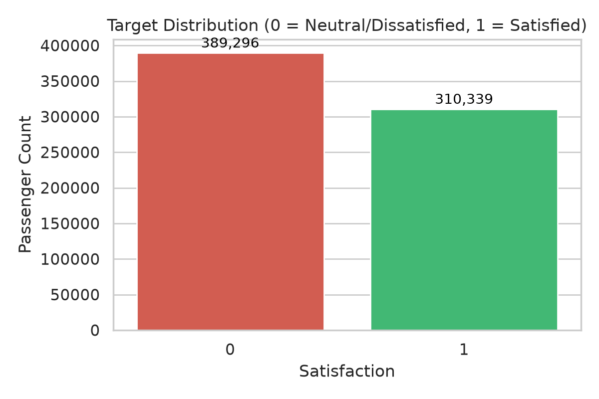
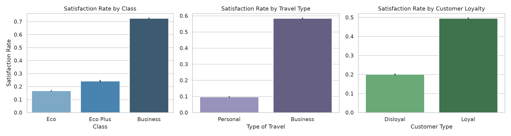
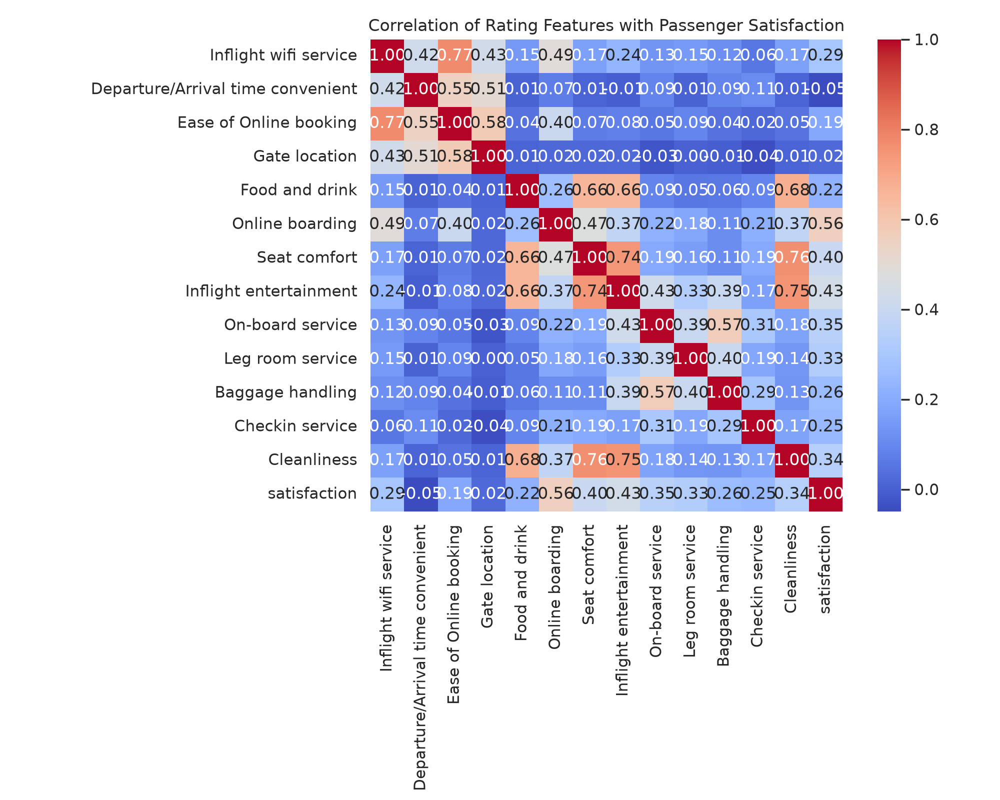
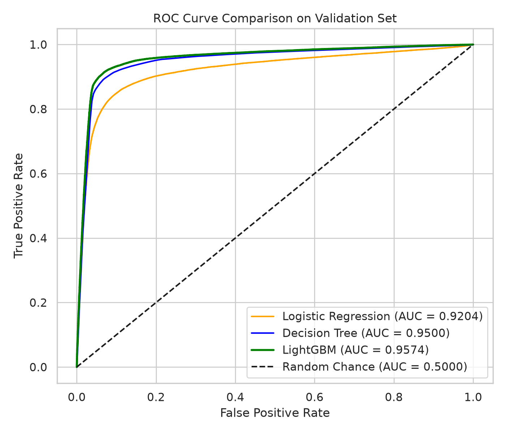
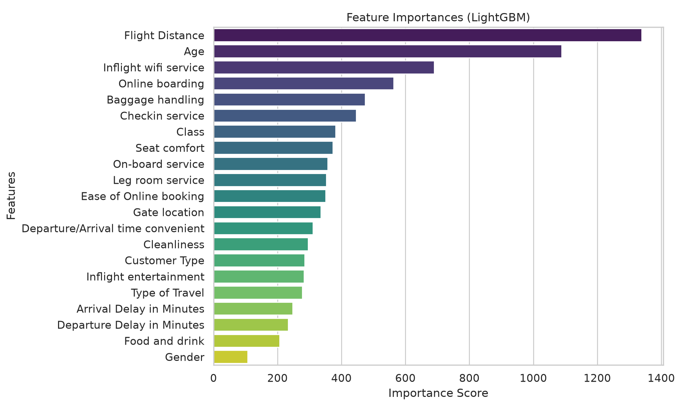

# Predicting Airline Passenger Satisfaction
Kaggle Playground Series (Season 6, Episode 10)

This is a personal machine learning project I built to practice solving a complete classification problem from scratch. The objective is to predict whether an airline passenger is satisfied or neutral/dissatisfied based on survey feedback, flight info, and passenger details.

Since I am a recent graduate exploring applied AI and machine learning, my main focus here was to keep things clean, understand the data thoroughly, and test how different types of models behave—starting with a simple baseline and moving to tree models.

---

## Project Highlights & Results

- **Exploratory Data Analysis**: Visualized class balance, customer segments, and service rating correlations.
- **Data Cleaning**: Filled missing arrival delay values using departure delay (since they correlate heavily) and converted categories into intuitive numerical representations.
- **Model Progression**:
  - Started with a **Logistic Regression** baseline on standardized features.
  - Evaluated a **Decision Tree Classifier** to capture non-linear relationships.
  - Trained a **LightGBM Classifier** to get fast gradient-boosted tree performance.
- **Evaluation**: Assessed models using Area Under the ROC Curve (ROC-AUC), accuracy, precision, recall, and confusion matrix.

### Model Comparison Table

| Model | Validation ROC-AUC | Validation Accuracy | Notes |
| :--- | :---: | :---: | :--- |
| **Logistic Regression** | 0.9204 | 87.79% | Standardized features, max_iter=500. Solid linear baseline. |
| **Decision Tree** | 0.9500 | 91.45% | max_depth=10 to prevent overfitting. Huge jump over linear model. |
| **LightGBM** | **0.9574** | **92.41%** | 300 estimators, learning_rate=0.08. Best performance across metrics. |

---

## Exploratory Data Analysis & Visuals

### 1. Target Distribution
The dataset is fairly well balanced between dissatisfied/neutral and satisfied passengers (~55.6% vs ~44.4%), which means I didn't need to apply aggressive re-sampling techniques like SMOTE.



### 2. Satisfaction by Passenger Segment
Looking at passenger segments revealed very clear patterns:
- Passengers traveling in **Business Class** have a drastically higher satisfaction rate than those in Economy.
- Passengers traveling for **Business** are far more satisfied on average than those flying for **Personal Travel**.
- **Loyal Customers** are noticeably more likely to report being satisfied compared to disloyal/first-time flyers.



### 3. Service Ratings Correlation
The survey includes ratings from 0 to 5 for various flight services. Looking at correlations with satisfaction:
- Features like **Online boarding**, **Inflight entertainment**, **Seat comfort**, and **Inflight wifi** showed strong positive correlations with passenger satisfaction.
- Features like **Gate location** and **Departure/Arrival time convenience** had surprisingly low correlation with whether someone was satisfied overall.



---

## Model Evaluation & ROC Curves

Since the competition ranks submissions using **ROC-AUC**, I tracked the true positive rate versus false positive rate across all decision thresholds.



### Feature Importance (LightGBM)
Checking the feature importances helped confirm the intuition gathered during EDA:
- **Online boarding** and **Inflight wifi service** were among the most decisive features used by the trees.
- **Age**, **Flight Distance**, and **Type of Travel** also contributed heavily to the splits.



---

## Repository Structure

```text
predicting_airline_satisfaction/
│
├── data/
│   ├── train.csv                # Training data with satisfaction target
│   ├── test.csv                 # Test data for submission predictions
│   └── sample_submission.csv    # Benchmark format
│
├── images/                      # Generated visualization plots
│   ├── target_distribution.png
│   ├── satisfaction_by_features.png
│   ├── correlation_matrix.png
│   ├── roc_curve.png
│   └── feature_importance.png
│
├── notebooks/
│   └── airline_passenger_satisfaction.ipynb  # Executed notebook with full EDA & code
│
├── train.py                     # Standalone Python script to train models & generate submission
├── submission.csv               # Final predicted probabilities for Kaggle test set
├── requirements.txt             # Core Python packages needed
└── README.md                    # Project documentation
```

---

## How to Run This Project

### Setting up the Environment

Clone the repository and navigate into the folder:
```bash
git clone https://github.com/your-username/predicting_airline_satisfaction.git
cd predicting_airline_satisfaction
```

Create a virtual environment and install dependencies:
```bash
python -m venv .venv
source .venv/bin/activate    # On Windows: .venv\Scripts\activate
pip install -r requirements.txt
```

### Running the Python Script
To train the models from scratch and regenerate `submission.csv`:
```bash
python train.py
```

### Running the Notebook
To explore the analysis and interactive charts cell by cell:
```bash
jupyter notebook notebooks/airline_passenger_satisfaction.ipynb
```

---

## Key Learnings & Personal Takeaways

- Starting with a simple baseline like Logistic Regression helped me establish a minimum score to beat before jumping into more complex algorithms.
- Handling missing data does not always need complex imputation; domain logic (like using departure delay for missing arrival delay) is simple and worked cleanly.
- Feature scaling was essential for Logistic Regression to converge nicely, whereas tree-based algorithms like Decision Tree and LightGBM worked well directly on the raw numerical values.
- As I learn more, I'd like to experiment with hyperparameter tuning using cross-validation and try feature interaction terms (such as combining departure and arrival delays into a total delay feature).
